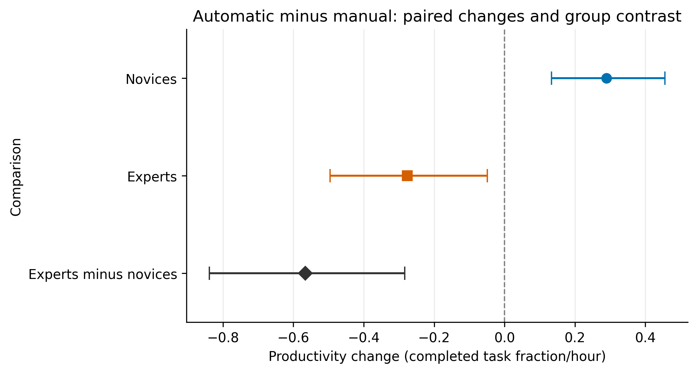
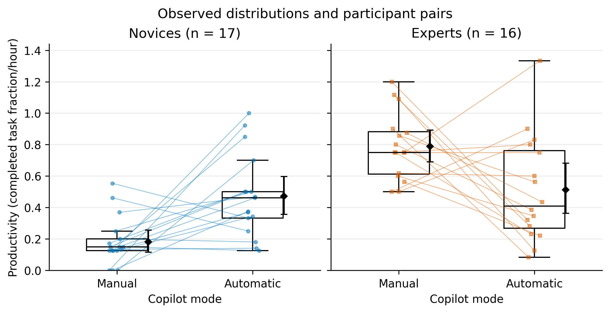
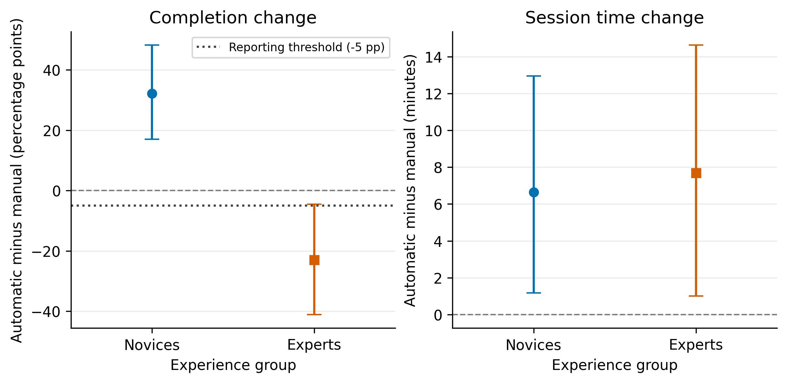
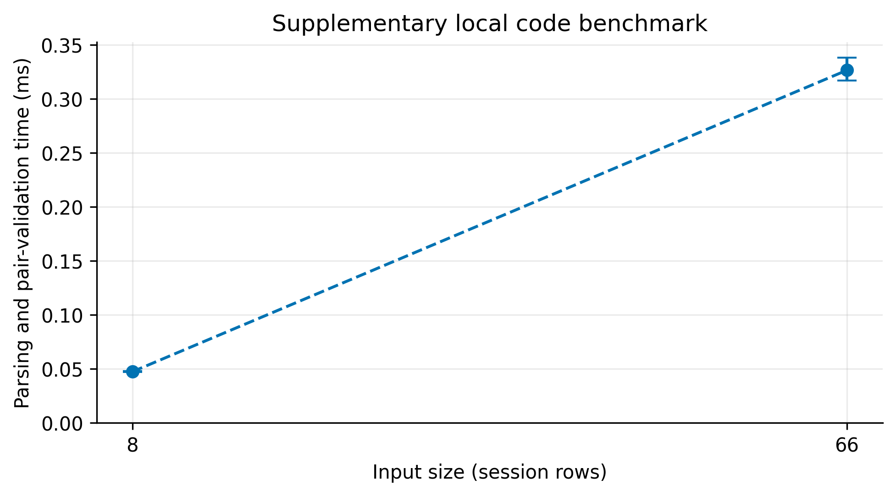

# Copilot Interaction Mode and Productivity Across Programmer Experience Levels

**Research Methods — Task 3**

**Authors:** Damir Makhmutov and Amir Kasimov

We analyze published Copilot measurements from 33 participants (17 novices and 16 experts), each with one automatic and one manual session. Both modes provide Copilot. This is an exploratory secondary analysis, not a new participant experiment.

The main question is whether the automatic-minus-manual productivity change differs between experience groups. We also report completion and time separately. A supplementary benchmark measures our CSV-processing code; those timings are kept separate from participant outcomes.

## Submission

- [Task 3 report for LMS](reports/task3_report.md)
- [Executed analysis notebook](notebooks/01_data_analysis.ipynb)
- [Domain model and measurement points](docs/domain_model.md)
- [Requirement checklist and limitations](docs/task3_checklist.md)
- [Analysis notes](docs/task3_analysis_notes.md)

Submit the public repository link and `reports/task3_report.md` in LMS. The report uses relative figure links, so use its GitHub page to view the complete illustrated version.

## Research questions and method

1. RQ1: What is the mean paired productivity change for novices?
2. RQ2: What is the mean paired productivity change for experts?
3. RQ3 (primary): Does the mean paired change differ between groups?

`Productivity = (completion_percent / 100) / (time_minutes / 60)`

The unit is completed task fraction/hour. Within-person changes are automatic minus manual. The primary contrast is the expert mean change minus the novice mean change. Manual invocation is the baseline, not an AI-free control.

We verify source hashes, values, published productivity, assignments, and complete participant pairs. All 66 observations are retained. Bootstrap intervals use 10,000 resamples of participant pairs within experience groups, seed 42. The [methodology passport](docs/Methodology_Passport.md) and [analysis protocol](docs/Analysis_Protocol.md) provide details.

## Results & Discussion


Manual is the baseline; automatic is the comparison condition, not a method invented by us. Mode values below are mean ± SD. Changes are mean [95% CI].

| Group | Outcome (unit) | Manual baseline | Automatic | Paired change [95% CI] |
| --- | --- | --- | --- | --- |
| Novice (n=17) | Productivity (task fraction/hour) | 0.182 ± 0.153 | 0.472 ± 0.262 | +0.290 [+0.134, +0.456] |
| Novice (n=17) | Completion (%; change in pp) | 18.824 ± 16.773 | 51.029 ± 25.831 | +32.206 [+17.059, +48.235] |
| Novice (n=17) | Session time (minutes) | 60.588 ± 4.963 | 67.235 ± 10.426 | +6.647 [+1.176, +12.941] |
| Expert (n=16) | Productivity (task fraction/hour) | 0.789 ± 0.213 | 0.513 ± 0.338 | -0.276 [-0.495, -0.049] |
| Expert (n=16) | Completion (%; change in pp) | 78.750 ± 15.055 | 55.781 ± 30.079 | -22.969 [-41.098, -4.531] |
| Expert (n=16) | Session time (minutes) | 61.750 ± 11.000 | 69.438 ± 12.296 | +7.688 [+1.000, +14.625] |

**RQ1:** Automatic suggestions are associated with higher productivity among novices in this sample. **RQ2:** Experts show the opposite average change. **RQ3:** The direct expert-minus-novice contrast is **-0.5660** task fraction/hour (95% CI [-0.8387, -0.2839]). This conclusion uses the direct group comparison, not a comparison of two significance decisions.



*Figure 1. Mean automatic-minus-manual productivity changes and the direct group contrast. Whiskers are participant-pair bootstrap 95% CIs. The dashed line marks no change.*



*Figure 2. All participant outcomes, linked within each pair. Boxes show p25–p75, the centre line is the median, and whiskers extend to observations within 1.5 IQR. All observations are plotted. Black diamonds and their bars show means and bootstrap 95% CIs.*



*Figure 3. Mean paired completion and session-time changes with bootstrap 95% CIs. The dotted completion line is the project-defined −5 percentage-point reporting threshold.*

Completion rises by 32.21 percentage points for novices but falls by 22.97 points for experts, triggering the expert completion guardrail. Session time increases in both groups, so the novice productivity increase must not be described as faster completion. Completion is a task score, not a security or comprehensive code-quality measure.

## Robustness and limitations

The primary contrast remains negative when each participant is removed in turn: the sensitivity range is −0.6233 to −0.5200, not a confidence interval. Equal weighting of automatic-task A/B within each group gives −0.5773. Session order is not adjusted because the available CSV labels do not establish the mapping to first/second period. We do not infer it from row order.

The small convenience sample, task differences, historical tool setting, and nonrandom experience groups limit generalization. This project was planned after inspecting the released data and findings. Bootstrap intervals do not remove confounding. Completion is not a comprehensive code-quality or security score.

## Reproduce the submission

Use Python 3.12. Local validation uses 3.12.14; Docker pins 3.12.12. Install the pinned dependency set once; analysis then runs offline. Raw CSVs are included and no Copilot account is needed.

```sh
python -m venv .venv
```

Activate the environment:

```powershell
# Windows PowerShell
.venv\Scripts\Activate.ps1
```

```sh
# macOS / Linux
source .venv/bin/activate
```

Then run from the repository root:

```sh
python -m pip install -r requirements.lock.txt
python -m unittest discover -s tests -v
python -m src.run_task3
python -m src.check_submission
```

The complete run recalculates statistics, collects local runtime logs, exports figures, regenerates the report, and executes the notebook in a fresh kernel. Statistical results are reproducible for fixed inputs and seed. New local timings and environment metadata will vary. `requirements.txt` lists direct dependencies; `requirements.lock.txt` pins the complete tested environment.

To run only selected steps:

```sh
python -m src.task3_analysis
python -m src.runtime_benchmark
python -m src.visualize
```

The notebook also supports Restart & Run All using the installed project environment. It recalculates human results and figures but analyzes the existing runtime log. Collect a new log explicitly with the runtime command or the complete runner.

### Docker

With Docker Desktop running in Linux-container mode:

```sh
docker build -t copilot-mode-study .
docker run --name task3-output copilot-mode-study
docker cp task3-output:/app/reports ./task3-reports
docker cp task3-output:/app/notebooks ./task3-notebooks
```

The image build runs the tests; the container run rebuilds all deliverables. Use a fresh container name if it already exists. GitHub Actions builds the same image, executes the full pipeline, validates the notebook and figure files, and uploads the reproduced outputs as an artifact. Local Docker execution requires a running Docker engine.

## Supplementary technical measurements

`data/raw/test_run.jsonl` contains 20 warm-up and 100 evaluation attempts for each of two real input sizes (8 and 66 rows). The timed operation is parsing preloaded CSV strings plus validating participant pairs. Source reads, hash checks, log writes, and aggregation are outside the timer. Failures count toward error rate; latency summaries describe successful evaluation attempts. IQR flags never delete timings. Hardware and software details are in `data/raw/runtime_metadata.json`.



*Mean local runtime with bootstrap 95% intervals. These fixed-input sequential measurements describe one local run and do not measure Copilot effectiveness.*

Human task sessions are never removed as technical warm-up. The [requirement checklist](docs/task3_checklist.md) explains this adaptation to the assignment.

## Project structure

```text
configs/                  Analysis and runtime settings
data/raw/                Original CSVs, provenance, small runtime JSONL
data/sample/             Four real participant pairs for tests
data/processed/          Validated sessions, paired changes, summary CSVs and JSON
docs/                    Methodology, C4 model, notes, requirement checklist
notebooks/               Executed 01_data_analysis.ipynb
reports/task3_report.md  Final Markdown report
reports/figures/         Four vector PDF / 300-DPI PNG pairs
src/                     Processing, statistics, timing, plots, report and runner
tests/                   Data, statistical and warm-up/error checks
outputs/                 Ignored temporary kernel and build files
```

## Contributions

The `task3-analysis` contribution adds the statistical module, tests, processed data, sensitivity checks, and domain model. The integration contribution adds the executed notebook, figures, separate runtime benchmark, report, reproducibility checks, and final packaging. Both contributions build on the Task 2 methodology and source validation. Git history records the work.

## Sources and license

Source study: Guglielmi et al., [How do Copilot Suggestions Impact Developers’ Frustration and Productivity?](https://doi.org/10.1007/s10664-026-10965-6). [Replication package](https://figshare.com/s/2f26b8ee294a3a87c908).

See [data attribution and provenance](data/README.md) for the original authors, CC BY 4.0 terms, and source hashes. The MIT code license does not replace the data license. We retain published IDs and do not attempt to identify participants.
