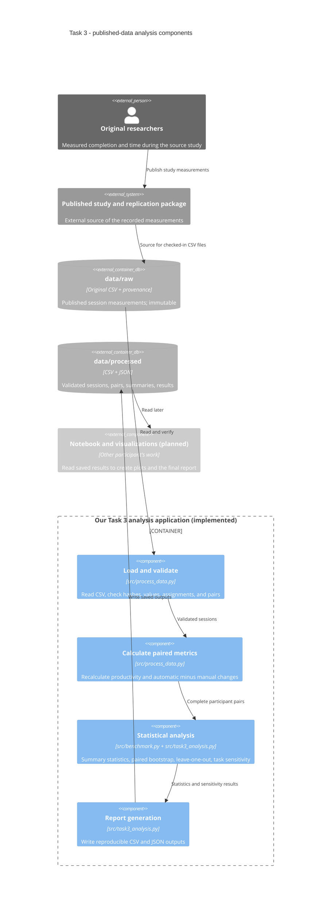

# Task 3 Domain Model (Software Engineering)

This application is a **secondary analysis**. The original researchers recruited participants, ran the Java tasks, and measured task completion and elapsed time. Our code did not recruit participants, run Copilot, or collect new measurements. See the [source paper](https://doi.org/10.1007/s10664-026-10965-6) and [data attribution](../data/README.md).

## C4 Component diagram

## Domain terms

- **Participant:** One person from the published study, identified by a source participant ID and classified as *novice* or *expert* by the original researchers.
- **Session:** One recorded task by one participant, with a Copilot mode, Java task A/B, completion percentage, and elapsed minutes. Each participant has two sessions.
- **Assignment:** A source `Study group` label A-D that identifies a task/mode allocation. The CSV does not independently record the session order; do not derive order from row position.
- **PairedChange:** For one participant and one metric, the automatic-session value minus the manual-session value. A participant is the unit of paired analysis.

## Formulas and units

- **Productivity (completed task fraction/hour):** `P = (completion_pct / 100) / (time_minutes / 60)`.
- **Paired productivity change (completed task fraction/hour):** `D = P_automatic - P_manual`.
- **Main contrast (completed task fraction/hour):** `mean(D_expert) - mean(D_novice)`. A positive sign favors experts on the *automatic relative to manual* comparison.
- **Completion change (percentage points):** `completion_pct_automatic - completion_pct_manual`. A group mean drop **greater than 5 percentage points** flags our reporting guardrail, not a universal quality rule.
- **Time change (minutes):** `time_minutes_automatic - time_minutes_manual`.
- **SD and quantiles:** Sample SD uses `n - 1` (`ddof=1`); p25, median, p75, and p95 use linear interpolation. Bootstrap 95% intervals use 10,000 participant-pair resamples within each experience group, seed 42. The leave-one-out range is a sensitivity check, **not** a confidence interval.

`src/process_data.py` recalculates session productivity and participant paired changes. `src/benchmark.py` calculates the original paired bootstrap and unadjusted summaries. `src/task3_analysis.py` adds sample SD, quantiles, leave-one-out, task-allocation standardization, and the five outputs in `data/processed/`. Notebook figures and narrative reporting are **planned**, not part of this implemented component boundary.
